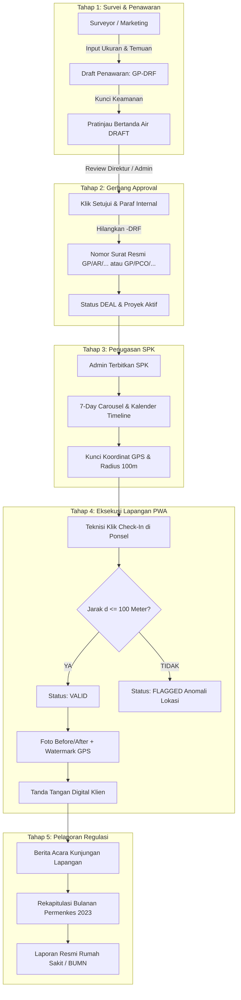

# Panduan Briefing Eksekutif & Materi Presentasi Stakeholder
**Platform Fieldwork PT Guci Emas Pratama**  
*Digitalisasi Operasional Lapangan, Integritas Geofencing Haversine, & Standarisasi Pelaporan Regulasi Permenkes No. 2 Tahun 2023*

> **Berkas Dokumen Resmi Word:**  
> `C:\Users\admin\Downloads\Materi_Presentasi_Stakeholder_Sistem_Fieldwork_PT_Guci_Emas_Pratama.docx`  
> *(Lengkap dengan visual flowchart gambar beresolusi tinggi, tabel eksekutif, skrip demo langsung 5 menit, dan FAQ manajemen)*

---

## 🧭 Ringkasan Eksekutif & Nilai Investasi (ROI)

Platform Fieldwork PT Guci Emas Pratama merupakan sistem operasional B2B komersial terintegrasi yang menghubungkan Direksi, Supervisor Administrasi, Staf Gudang, Tenaga Pemasaran (Marketing), dan Teknisi Lapangan ke dalam satu ekosistem data yang terverifikasi, terenkripsi, dan mematuhi regulasi nasional.

### 4 Metrik Efisiensi Terukur:
1. **Waktu Rekapitulasi Bulanan:** Dari **3–5 hari kerja manual** menjadi **instan (< 2 menit)** via 1-klik generator PDF resmi.
2. **Validasi Kehadiran Teknisi:** Dari 0% (hanya percaya tanda tangan kertas) menjadi **100% terverifikasi satelit** dalam radius aman 100 meter.
3. **Integritas Bukti Foto Lapangan:** Foto pengerjaan terikat **watermark tamper-evident** koordinat GPS, waktu, dan nama proyek yang tidak dapat dimanipulasi.
4. **Kepatuhan Regulasi Nasional:** Mengotomatiskan perhitungan **Standar Baku Mutu Kesehatan Lingkungan (SBMKL)** Permenkes No. 2 Tahun 2023 dan standar dosis termisida SNI 2404.

---

## 🔄 Alur Proses Bisnis End-to-End

---

## 📐 Logika Validasi Kehadiran: Algoritma Haversine Formula

Sistem menghitung jarak lingkaran besar (*great-circle distance*) antara titik proyek pelanggan $(\text{lat}_1, \text{lon}_1)$ dan titik fisik ponsel teknisi $(\text{lat}_2, \text{lon}_2)$ dengan jari-jari bola bumi $R = 6.371.000\text{ meter}$:

$$\Delta\phi = (\text{lat}_2 - \text{lat}_1) \times \frac{\pi}{180}, \quad \Delta\lambda = (\text{lon}_2 - \text{lon}_1) \times \frac{\pi}{180}$$

$$a = \sin^2\left(\frac{\Delta\phi}{2}\right) + \cos\left(\text{lat}_1 \times \frac{\pi}{180}\right) \times \cos\left(\text{lat}_2 \times \frac{\pi}{180}\right) \times \sin^2\left(\frac{\Delta\lambda}{2}\right)$$

$$c = 2 \times \text{atan2}\left(\sqrt{a}, \sqrt{1 - a}\right), \quad d = R \times c$$

- **Jika $d \le 100\text{ meter}$:** Status **VALID** (Kehadiran sah di area kerja pelanggan).
- **Jika $d > 100\text{ meter}$:** Status **FLAGGED** (Penanda anomali lokasi untuk audit supervisor kantor).
- **Kompensasi GPS Satelit:** Dibatasi maksimal 35m untuk mencegah manipulasi (*fake GPS*).

---

## 👥 Matriks 6 Peran Pengguna (Strict RBAC)

| Peran Pengguna | Wewenang Akses | Batasan Keamanan |
| :--- | :--- | :--- |
| **Master Super Admin** | Konsol multi-perusahaan, lisensi tenant, token kuota. | Terisolasi dari data privat operasional tenant. |
| **Superadmin / Direktur** | Approval penawaran, analisis untung rugi proyek, laba bahan kimia. | Melihat seluruh KPI omzet & margin bisnis. |
| **Admin Operasional** | Penugasan SPK, audit anomali geofence, rekapitulasi Permenkes. | Dilarang melihat keuntungan bersih chemical Direktur. |
| **Marketing / Surveyor** | Input survei, draf penawaran, pantau konversi MoM pribadi. | Dilarang unduh berkas sebelum di-ACC Direktur. |
| **Inventory / Gudang** | Katalog obat, mutasi masuk/keluar, tren bahan kimia. | Dilarang melihat valuasi laba rugi proyek. |
| **Teknisi Lapangan** | Presensi GPS, foto watermark, checklist hama, tanda tangan digital. | Hanya melihat tugas hari ini di ponsel (PWA). |

---

## ⏱️ Skrip Panduan Live Demo Stakeholder (Skenario 5 Menit)

1. **Menit 01 — Login Demo & Dasbor Personal Eksekutif:**  
   Buka halaman login $\rightarrow$ Klik 1-klik akun demo Direktur/Admin $\rightarrow$ Tunjukkan 4 kartu Analytics Bento (Operation Center, Peta Live, Performa Tim, dan Kontrak Bisnis).
2. **Menit 02 — Siklus Penawaran Harga & Approval Resmi:**  
   Buka tab Penawaran Harga $\rightarrow$ Tunjukkan draf baru `GP-DRF` terkunci unduh $\rightarrow$ Klik "Setujui (ACC)" $\rightarrow$ Tunjukkan nomor berubah seketika menjadi nomor resmi `GP/AR/...` tanpa kode `APR` $\rightarrow$ Pratinjau cetakan PDF.
3. **Menit 03 — Penjadwalan SPK & Peta Radius Geofence:**  
   Buka tab Penugasan & Proyek SPK $\rightarrow$ Tunjukkan kalender 7-Day Carousel interaktif $\rightarrow$ Perlihatkan visualisasi lingkaran radius geofence 100 meter di peta.
4. **Menit 04 — Pengalaman Teknisi di Smartphone (PWA):**  
   Buka portal Teknisi Lapangan $\rightarrow$ Klik tombol "Check-In" $\rightarrow$ Tunjukkan validasi jarak Haversine (status VALID) $\rightarrow$ Kamera langsung dengan watermark otomatis waktu & koordinat GPS $\rightarrow$ Minta salah satu stakeholder membubuhkan tanda tangan digital di layar.
5. **Menit 05 — Penerbitan Laporan Kunjungan & Rekapitulasi Permenkes:**  
   Kembali ke dashboard Admin $\rightarrow$ Buka Hasil & Verifikasi Kerja $\rightarrow$ Klik tombol "Rekap Pest Control (Permenkes)" $\rightarrow$ Tunjukkan tabel matriks gedung/ruangan otomatis terisi dan indeks SBMKL terhitung $\rightarrow$ Klik "Unduh Rekap PDF".

---

## 🚀 Roadmap Peningkatan Pasca-Presentasi (Phase 8)

Setelah presentasi stakeholder disahkan, rencana peningkatan teknis yang tertuang dalam `docs/prd/phase_8_prd.md` akan diimplementasikan:
1. **Otomasi Handover 1-Klik:** Penawaran Deal langsung mengisi formulir pembuatan SPK lapangan tanpa input ulang.
2. **Rekonsiliasi Stok Gudang Otomatis:** Laporan pengerjaan yang disetujui otomatis memotong stok bahan kimia terkait di gudang.
3. **Multi-Visit Auto-Pull:** Pengambilan otomatis seluruh riwayat kunjungan 1 bulan kalender klien pada Permenkes Recap Builder.
4. **Telemetri Armada (Fleet Journey):** Pemantauan rute perjalanan teknisi dan penghitungan kilometer harian.
